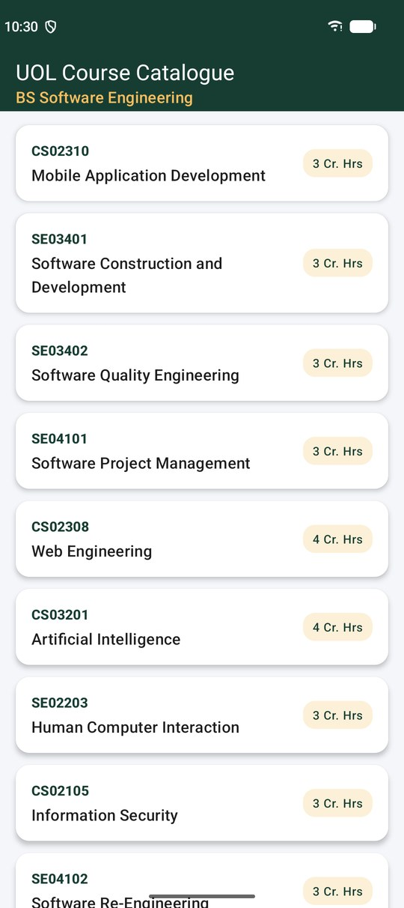
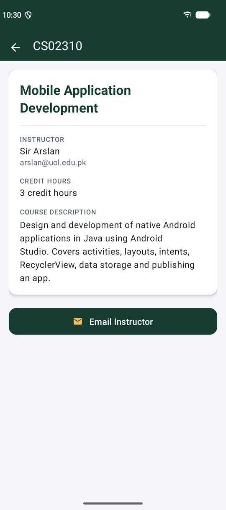
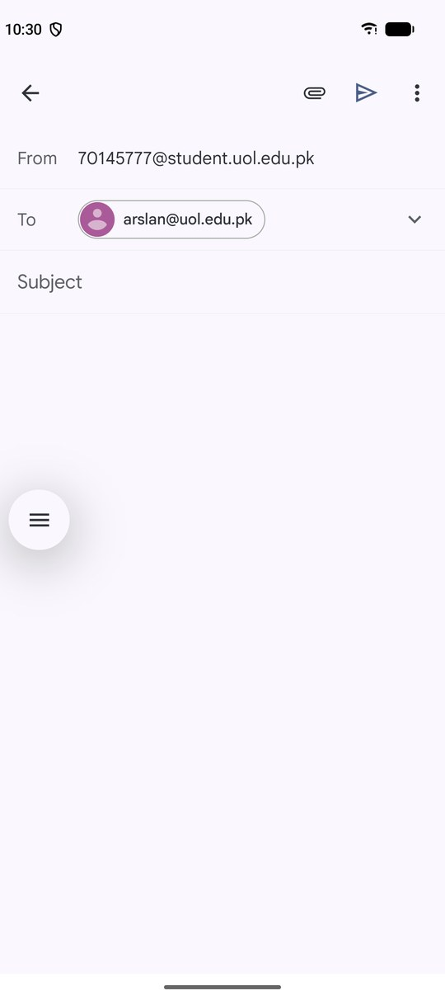
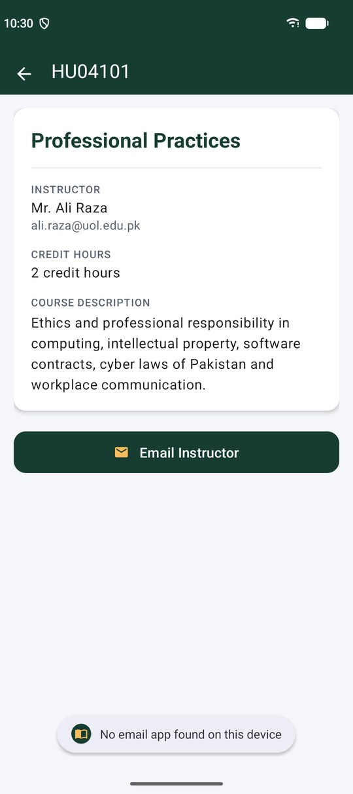
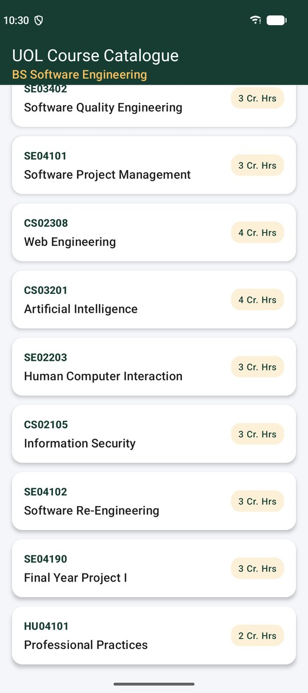
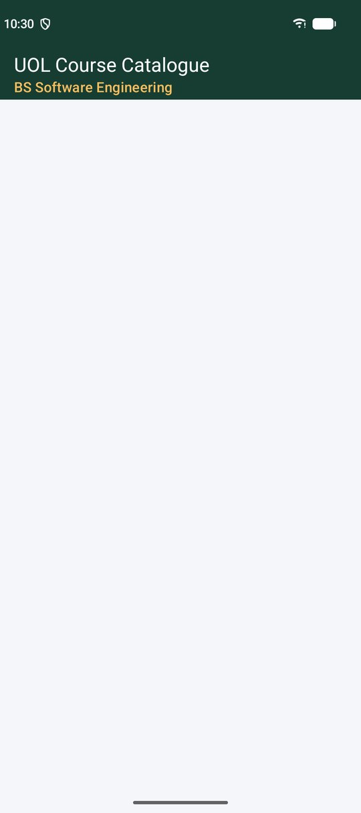
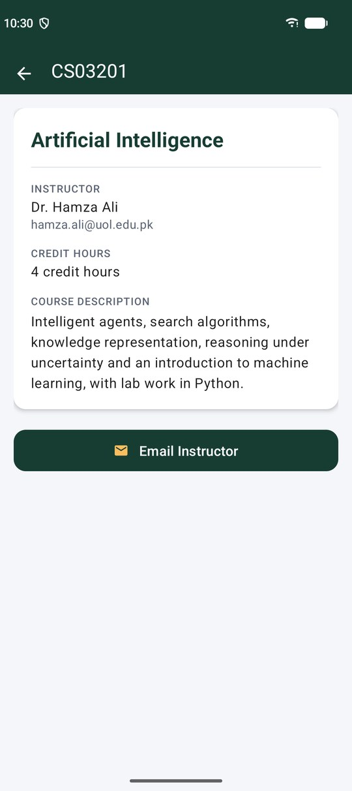
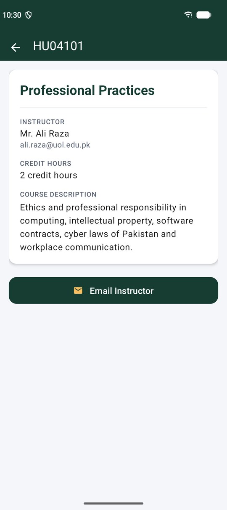
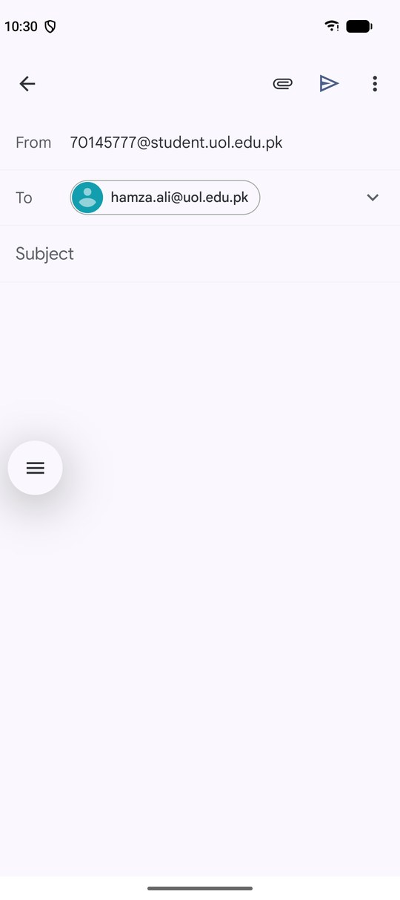

# UOL Course Catalogue

A two-screen Android app in Java that lists the courses of the BS Software Engineering programme at The University of Lahore and opens the details of any course the student taps. I built it for Lab Task 02 (RecyclerView) of Mobile Application Development (CS02310), Fall 2026, Section S.

Abu Huraira, SAP ID 70145777, Section S

<p>
  
  
  
  
</p>

## How the app is put together

| Part | File | What it does |
|---|---|---|
| Model class | `Course.java` | Holds one course: code, title, instructor, email, description and credit hours, with a getter for each field |
| Item layout | `item_course.xml` | One course card. The root is a `CardView` with `app:cardCornerRadius` and `app:cardElevation`, and it has three TextViews for the code, the title and the credit hours |
| Adapter and ViewHolder | `CourseAdapter.java` | Writes each course into its card. The static inner `CourseViewHolder` finds the three TextViews once in its constructor |
| Click interface | `CourseAdapter.OnItemClickListener` | `onItemClick(int position)` tells `MainActivity` which card was tapped |
| List screen | `MainActivity.java` | Builds an `ArrayList` of 11 courses, sets a `LinearLayoutManager` on `rvCourses` and attaches the adapter |
| Details screen | `CourseDetailActivity.java` | Reads the extras, shows the course and sets the screen title to the course code |

What happens on one tap:

```
tap on a card
  -> click listener on itemView (in the ViewHolder) reads getBindingAdapterPosition()
  -> onItemClick(position) in MainActivity
  -> courses.get(position)
  -> explicit Intent with only that course's data (putExtra)
  -> CourseDetailActivity
```

## Scenario 1: the course list

The list shows 11 courses of the programme. Each card has the course code, the title and a small badge with the credit hours. The list scrolls down to the last course, Professional Practices.

<p>
  
  
</p>

The adapter overrides the three required methods:

```java
@Override
public CourseViewHolder onCreateViewHolder(@NonNull ViewGroup parent, int viewType) {
    View itemView = LayoutInflater.from(parent.getContext())
            .inflate(R.layout.item_course, parent, false);
    return new CourseViewHolder(itemView, listener);
}

@Override
public void onBindViewHolder(@NonNull CourseViewHolder holder, int position) {
    Course course = courses.get(position);
    holder.tvCode.setText(course.getCode());
    holder.tvTitle.setText(course.getTitle());
    holder.tvCreditHours.setText(holder.itemView.getContext()
            .getString(R.string.credit_hours_short, course.getCreditHours()));
}

@Override
public int getItemCount() {
    return courses.size();
}
```

### Running without setLayoutManager()

For step 5 I commented out `rvCourses.setLayoutManager(new LinearLayoutManager(this));` and ran the app again. It did not crash. The toolbar was there, but the area below it stayed empty, and Logcat printed:

```
E RecyclerView: No layout manager attached; skipping layout
```

RecyclerView does not place its children by itself. It hands measuring and positioning of every item to its LayoutManager, so without one it skips the layout pass, never asks the adapter to create or bind a single ViewHolder, and shows nothing even though the adapter holds 11 courses. I put the call back afterwards.



## Scenario 2: the course details screen

Tapping a card opens `CourseDetailActivity` for that course only. I tested it with three different courses, one of them after scrolling to the bottom of the list:

<p>
  
  
  
</p>

`MainActivity` reads the tapped course from the list and sends only its data:

```java
@Override
public void onItemClick(int position) {
    Course course = courses.get(position);

    Intent intent = new Intent(MainActivity.this, CourseDetailActivity.class);
    intent.putExtra(CourseDetailActivity.EXTRA_CODE, course.getCode());
    intent.putExtra(CourseDetailActivity.EXTRA_TITLE, course.getTitle());
    intent.putExtra(CourseDetailActivity.EXTRA_INSTRUCTOR, course.getInstructor());
    intent.putExtra(CourseDetailActivity.EXTRA_EMAIL, course.getEmail());
    intent.putExtra(CourseDetailActivity.EXTRA_DESCRIPTION, course.getDescription());
    intent.putExtra(CourseDetailActivity.EXTRA_CREDIT_HOURS, course.getCreditHours());
    startActivity(intent);
}
```

The keys are `public static final String` constants in `CourseDetailActivity`, which reads them back with `getStringExtra()` and `getIntExtra()` and calls `setTitle(code)`.

The position is used because it is the only thing the click tells us. The card's views are recycled for other courses, so the position is what links the tapped card to the right `Course` in the same list the adapter was built from, and `courses.get(position)` returns exactly that course.

### Email Instructor

```java
private void emailInstructor(String email) {
    Intent intent = new Intent(Intent.ACTION_SENDTO, Uri.parse("mailto:" + email));
    try {
        startActivity(intent);
    } catch (ActivityNotFoundException e) {
        Toast.makeText(this, R.string.toast_no_email_app, Toast.LENGTH_SHORT).show();
    }
}
```

`ACTION_SENDTO` with a `mailto:` Uri is handled only by email apps. Gmail opened with the instructor of the tapped course in the To field (first two screenshots below). To test the catch block I disabled Gmail on the emulator and pressed the button again, and the app showed the Toast instead of crashing.

<p>
  
  
  
</p>

## Courses in the app

| Code | Title | Credit hours |
|---|---|---|
| CS02310 | Mobile Application Development | 3 |
| SE03401 | Software Construction and Development | 3 |
| SE03402 | Software Quality Engineering | 3 |
| SE04101 | Software Project Management | 3 |
| CS02308 | Web Engineering | 4 |
| CS03201 | Artificial Intelligence | 4 |
| SE02203 | Human Computer Interaction | 3 |
| CS02105 | Information Security | 3 |
| SE04102 | Software Re-Engineering | 3 |
| SE04190 | Final Year Project I | 3 |
| HU04101 | Professional Practices | 2 |

The instructor names and email addresses (apart from Sir Arslan for CS02310) are sample data for the lab.

## Project structure

```
app/src/main/
  AndroidManifest.xml                 MainActivity (launcher) and CourseDetailActivity
  java/com/example/uolcoursecatalogue/
    Course.java                       model class
    CourseAdapter.java                adapter, static ViewHolder, OnItemClickListener
    MainActivity.java                 course list, onItemClick()
    CourseDetailActivity.java         details screen, Email Instructor
  res/layout/
    activity_main.xml                 toolbar and RecyclerView rvCourses
    item_course.xml                   CardView for one course
    activity_course_detail.xml        details screen
app/src/test/.../CourseTest.java      unit test for the model class
```

## Build and run

- Android Studio Panda 4, Java, Empty Views Activity template
- `androidx.recyclerview:recyclerview:1.3.2` and `androidx.cardview:cardview:1.0.0`
- compileSdk 36.1, targetSdk 36, minSdk 24
- Tested on a Pixel 9 emulator (Android 17, Google Play image)

Open the folder in Android Studio and run the `app` configuration, or from a terminal:

```
gradlew assembleDebug
gradlew testDebugUnitTest
```
